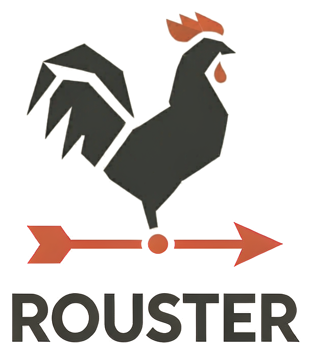

<p align="center">
  
</p>

<p align="center">
  <a href="https://github.com/li-ch/rouster/actions/workflows/ci.yml"></a>
</p>

# Rouster

A routing protocol suite in Rust — **rou**ter + Ru**st**.

Rouster is not an FRR clone. It fuses BIRD's and Holo's core architecture,
keeps FRR compatibility strictly at the edge, and adds native source address
validation: a BIRD-style typed multi-table RIB, Holo-style async and
AF-generic protocol crates, FRR compatibility (ZAPI, vtysh, frr.conf) as
edge adapters only, and SAVNET-first source address validation as a
first-class subsystem. The reasoning is recorded in
[docs/architecture.md](docs/architecture.md); the phase plan lives in
[docs/implementation-plan.md](docs/implementation-plan.md).

## Status — early stage

Phases 0–1.5 of the plan are landed and exercised by a container-based
smoke suite (`scripts/run-smokes.sh`). What actually runs today:

- **zebra-equivalent core** (`rousterd`): a BIRD-style typed multi-table
  RIB with a Linux netlink dataplane — interface, address, route and
  neighbour state mirrored from the kernel, static routes programmed back
  (including ECMP and non-main tables), VRF devices and their routing
  tables mirrored and programmed without leaking into the main table.
  SIGHUP reloads the config without bouncing anything.
- **ZAPI edge — proven against real FRR 10.2.2**: unmodified FRR daemons
  attach to rousterd as their zebra, and their routes reach the kernel
  through the Rust RIB (`proto static`, `proto bgp`, `proto ospf`):
  - `staticd` installs its configured routes (`scripts/test-z4-staticd.sh`,
    `scripts/test-z5-frr-interop.sh`);
  - two `bgpd`s establish iBGP through rousterd and exchange routes
    (`scripts/test-z5b-bgpd-interop.sh`);
  - two `ospfd`s reach Full adjacency; each router's loopback is installed
    by the other side (`scripts/test-z5c-ospfd-interop.sh`), plus
    redistribute-connected (`…z5d…`) and nexthop-tracking / NSSA
    default-originate (`…z5e…`) variants.
  Results and known deviations: [docs/interop/frr-10.2-interop.md](docs/interop/frr-10.2-interop.md).
  The wire codec is pinned against the real 10.2.2 binary in
  [docs/interop/zapi-10.2-pinned.md](docs/interop/zapi-10.2-pinned.md).
- **rousterctl — operator CLI**: `rousterctl show sav [--json]` reads
  savd's published status (installed rule set, running-config summary,
  monitor counters, pid liveness) and `rousterctl status` inventories the
  run dir; v1 is read-only over the
  [run-dir contract](docs/operator-surfaces.md) (`/run/rouster/`) —
  no daemon, no IPC, the CLI never writes the run dir.
- **savd — native source address validation**: a SAV Information Base fed
  from the RIB and config; the IBA/IBB/PBA/PBB validation-mode rule model
  (draft-ietf-savnet-general-sav-capabilities); uRPF-family rule
  generation (RFC 3704/8704); enforcement behind the dataplane trait
  (an `rp_filter` backend today). Monitor-only by default — drop mode
  refuses without an explicit opt-in, and spoof-block/legit-pass are
  exercised with real traffic (`scripts/test-w7-sav.sh`,
  `scripts/test-w8-savd.sh`). No general-purpose suite (FRR, BIRD, Holo)
  ships packet-plane SAV today; the plan's §4 has the strategic framing.

Not there yet, per the plan: native protocol daemons (BFD/BGP in Phase 2,
OSPF in Phase 3) and the YANG northbound + vtysh shim (Phase 4). Until the
native daemons exist, the protocol daemons in every interop topology above
are FRR's — that is the point of building the ZAPI edge first.

## Quickstart

Prerequisites: Linux (netlink), Rust stable, and Docker for the smoke
suite. On macOS, run the smokes in a Linux VM/Docker Desktop — the daemon
needs a Linux kernel.

```sh
cargo build --release

# rouster.conf — an FRR-flavored strict subset (valid input for the
# future frr.conf importer):
#   ip   route <PREFIX> {<GATEWAY>... | blackhole} [table <N>]
#   ipv6 route <PREFIX> {<GATEWAY>... | blackhole} [table <N>]
#   zapi socket <PATH>        # enable the ZAPI edge server (default: off)
cat > rouster.conf <<'EOF'
ip route 198.51.100.0/24 blackhole
zapi socket /run/rouster/zserv.api
EOF

./target/release/rousterd --config rouster.conf   # --once: install and exit
```

Unit and property tests:

```sh
cargo test --workspace
```

Smoke suite (per-script container topologies, self-cleaning):

```sh
scripts/run-smokes.sh            # everything
scripts/run-smokes.sh 'z5*'      # just the FRR-interop smokes
```

The smoke scripts **never pull images**. The kernel-level smokes need any
cached Linux base image; the FRR interop smokes need a locally cached FRR
10.2.2 test image (FRR daemons + full iproute2) tagged `frr-testbed:10.2.2`
— build one from `frrouting/frr:10.2.2` or point
`ROUSTER_TEST_BASE_IMAGE` at an equivalent. Rousterd itself is built on
the host for musl and copied in; no Rust build image is needed. Logs land
in `target/smoke-logs/`.

## Repository layout

```
crates/
  common/      shared types: prefixes, nexthops, interfaces, link flags
  rib/         BIRD-style typed multi-table RIB core
  netlink-dp/  Linux netlink dataplane behind the Dataplane trait
  zapi/        FRR ZAPI codec + edge server (plus sniff/probe dev tools)
  rousterd/    the daemon; also builds the staticd ZAPI client (FRR shape)
  rousterctl/  operator CLI over the run-dir contract (show sav, status)
  sav/         SIB, SAV rule model, uRPF generation, table manager, savd
scripts/       smoke suite (scripts/test-*.sh) + the run-smokes.sh runner
docker/        test image definitions
topologies/    Containerlab topologies
docs/          architecture, implementation plan, interop records
```

## Documentation

Start at [docs/README.md](docs/README.md) for the index. The two documents
that define the project are [docs/architecture.md](docs/architecture.md)
(the core/edge decision) and
[docs/implementation-plan.md](docs/implementation-plan.md) (phases, SAVNET
workstream rules, risks, and the append-only status log in its Appendix C).

## License

MIT — see [LICENSE](LICENSE).
